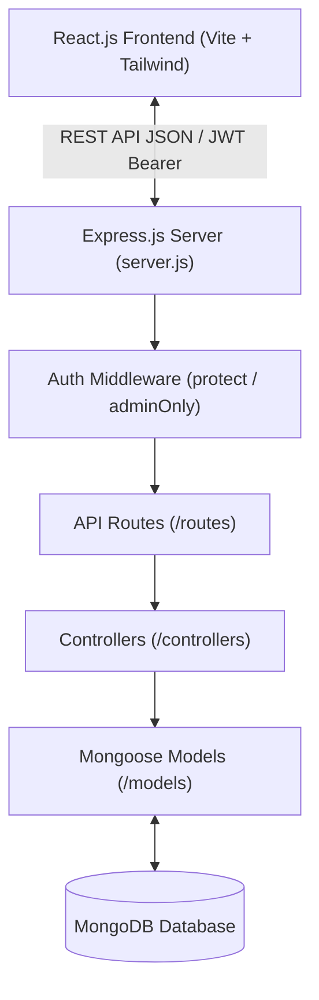
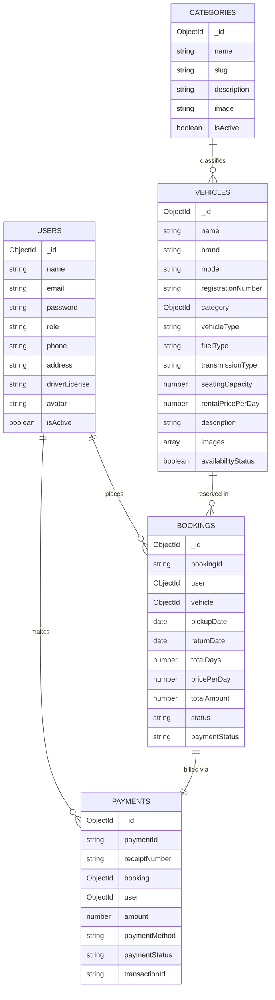

# 🚗 Vehicle Rental Management System (VRMS)
### Complete Full Stack Development (FSD) Academic Capstone Project

A complete, responsive, and production-grade **Vehicle Rental Management System (VRMS)** engineered using the **MERN Stack** (MongoDB, Express.js, React.js, Node.js) with Tailwind CSS, JWT Authentication, and RESTful MVC architecture.

---

## 📋 Table of Contents
1. [Project Overview](#-project-overview)
2. [Technology Stack](#-technology-stack)
3. [System Architecture & MVC Pattern](#-system-architecture--mvc-pattern)
4. [Module Breakdown & Key Features](#-module-breakdown--key-features)
5. [Database Collections & Schemas](#-database-collections--schemas)
6. [Folder & File Structure](#-folder--file-structure)
7. [Installation & Setup Instructions](#-installation--setup-instructions)
8. [Database Seeding & Default Credentials](#-database-seeding--default-credentials)
9. [RESTful API Documentation](#-restful-api-documentation)
10. [Business Rules & Booking Conflict Logic](#-business-rules--booking-conflict-logic)
11. [Academic Viva Voce & Presentation Q&A](#-academic-viva-voce--presentation-qa)

---

## 🌟 Project Overview
The **Vehicle Rental Management System (VRMS)** is an end-to-end self-drive rental platform designed to streamline vehicle reservations, fleet inventory management, automated pricing calculations, conflict-free booking scheduling, and financial reporting. 

It provides two distinct user experiences:
1. **Customer Portal**: Vehicle discovery, filterable catalog, dynamic pricing calculator, calendar availability checking, instant checkout with simulated payment gateway, booking history tracking, cancellation, and downloadable/printable PDF payment receipts.
2. **Administrator Portal**: Real-time KPI analytics, vehicle inventory CRUD, category management, booking lifecycle management (Approve, Activate, Complete, Cancel), customer account oversight, and revenue ledger breakdown.

---

## 🛠 Technology Stack

### Frontend:
- **Library**: React.js (v18+) with Vite build tool
- **Styling**: Tailwind CSS (v3), PostCSS, Autoprefixer
- **Icons**: Lucide React
- **Routing**: React Router DOM (v7)
- **HTTP Client**: Axios with global interceptors for JWT injection
- **State Management**: React Context API (`AuthContext`)

### Backend:
- **Runtime**: Node.js (v18+)
- **Framework**: Express.js (v4 REST API with ES Modules)
- **Database Driver**: Mongoose (v8 ODM)
- **Authentication**: JSON Web Tokens (`jsonwebtoken`)
- **Password Security**: `bcryptjs` with salted hashing
- **Middleware**: CORS, Morgan HTTP logger, Custom Error Handler, Protected/Admin Route Guards

### Database:
- **Database**: MongoDB (Local Instance or MongoDB Atlas Cloud)
- **Collections**: `users`, `vehicles`, `categories`, `bookings`, `payments`

---

## 🏛 System Architecture & MVC Pattern

The backend follows the **Model-View-Controller (MVC)** architectural pattern:



---

## 📦 Module Breakdown & Key Features

### 1. User Module
- User registration and login with bcrypt password hashing.
- Profile management (name, phone, address, driver license, avatar).
- Password change with old password verification.
- Search vehicles by name, brand, model, and category.
- Filter vehicles by price range, fuel type, transmission, and seating.
- Real-time date range availability checker preventing overlap.
- Dynamic rental cost calculation (`days * pricePerDay + 12% GST`).
- Booking history tracking with status badges.
- Self-service cancellation (subject to cancellation business rules).
- Digital receipt invoice generation with print/save as PDF support.

### 2. Admin Module
- Secured administrative login guard (`adminOnly` middleware).
- KPI Dashboard overview:
  - Total fleet vehicles & available vehicles
  - Total active rentals & completed bookings
  - Total registered users
  - Gross revenue & fleet utilization rate (%)
- Vehicle Inventory Management:
  - Add new vehicle with complete specifications and image URLs
  - Update vehicle specifications, rental rates, and location
  - Delete vehicle (with active booking cascade protection)
  - 1-Click availability toggle (Available / In Service)
- Vehicle Categories Management:
  - Create, view, update, and delete vehicle categories (SUV, Sedan, EV, Sports, Van, etc.)
- Bookings Management:
  - Filter bookings by status (Pending, Confirmed, Active, Completed, Cancelled)
  - Quick status dropdown action (Confirm, Mark Active, Mark Completed, Reject)
  - View full payment receipt for any booking
- User Account Management:
  - View all registered customers with total booking count
  - Toggle user account status (Active / Deactivated)
  - Promote or demote user roles (Admin / Customer)
- Revenue Audit Report:
  - Financial summary with channel breakdown (Credit Card, UPI, Debit Card, Cash)
  - Transaction ledger with search and export receipts

### 3. Vehicle Management Specifications
Each vehicle record includes:
- `name`, `brand`, `model`, `registrationNumber` (Unique)
- `category` (Reference to Category collection)
- `vehicleType` (e.g., Luxury Sedan, Premium SUV, Electric)
- `fuelType` (Petrol, Diesel, Electric, Hybrid, CNG)
- `transmissionType` (Automatic, Manual)
- `seatingCapacity` (e.g., 4, 5, 7, 8)
- `rentalPricePerDay` (in INR ₹)
- `description`, `images` (array of image URLs)
- `availabilityStatus` (Boolean)
- `features` (GPS, Bluetooth, Sunroof, Heated Seats, etc.)
- `mileage`, `rating`, `location`

### 4. Booking & Scheduling Management
- Date validation: Pickup date must be today or future; return date must be at least 1 day after pickup.
- Automatic day calculation (`Math.ceil((returnDate - pickupDate) / (1000 * 60 * 60 * 24))`).
- Overlapping booking detection: Queries database for existing `Pending`, `Confirmed`, or `Active` reservations overlapping with the requested date range.
- Unique booking reference code generation: `VRMS-YYYYMMDD-XXXX`.

### 5. Payment & Invoice Module
- Automatic computation of rental fees + 12% GST/platform surcharge.
- Simulated payment options: Online Card / NetBanking / UPI or Cash on Pickup.
- Automatic generation of Payment ID and Receipt Number (`RCP-XXXXXX`).
- Printable, high-definition tax invoice modal with printer-friendly styling.

---

## 🗄 Database Collections & Schemas



---

## 📂 Folder & File Structure

```
vehicle-rental-system/
├── package.json                   # Root package manager script
├── README.md                      # Comprehensive project documentation
│
├── backend/                       # RESTful Node.js / Express Backend
│   ├── .env                       # Environment configuration
│   ├── .env.example               # Example environment template
│   ├── package.json               # Backend dependencies
│   ├── server.js                  # Express application entrypoint
│   ├── seeder.js                  # Database seeder script
│   │
│   ├── config/
│   │   └── db.js                  # Mongoose MongoDB connection
│   │
│   ├── models/
│   │   ├── User.js                # User Mongoose schema & bcrypt hooks
│   │   ├── Category.js            # Category Mongoose schema
│   │   ├── Vehicle.js             # Vehicle Mongoose schema & indexes
│   │   ├── Booking.js             # Booking Mongoose schema
│   │   └── Payment.js             # Payment & Invoice Mongoose schema
│   │
│   ├── controllers/
│   │   ├── authController.js      # Register, Login, Profile, Password
│   │   ├── categoryController.js  # Category CRUD
│   │   ├── vehicleController.js   # Vehicle CRUD & Availability Check
│   │   ├── bookingController.js   # Booking Creation, Overlap Check, Status
│   │   ├── paymentController.js   # Payment Processing & Receipts
│   │   ├── dashboardController.js # Admin & User KPIs, Revenue Reports
│   │   └── userController.js      # User Administration & Role Updates
│   │
│   ├── middleware/
│   │   ├── authMiddleware.js      # JWT Verification & Role Guards
│   │   └── errorMiddleware.js     # 404 & Global Centralized Error Handler
│   │
│   ├── routes/
│   │   ├── authRoutes.js          # /api/auth
│   │   ├── categoryRoutes.js      # /api/categories
│   │   ├── vehicleRoutes.js       # /api/vehicles
│   │   ├── bookingRoutes.js       # /api/bookings
│   │   ├── paymentRoutes.js       # /api/payments
│   │   ├── dashboardRoutes.js     # /api/dashboard
│   │   └── userRoutes.js          # /api/users
│   │
│   └── utils/
│       ├── generateToken.js       # JWT Token generator
│       └── seedData.js            # Initial realistic mock data
│
└── frontend/                      # React.js + Vite + Tailwind Frontend
    ├── index.html                 # Single page application HTML entry
    ├── package.json               # Frontend dependencies
    ├── vite.config.js             # Vite configuration with /api proxy
    ├── tailwind.config.js         # Tailwind design tokens & themes
    ├── postcss.config.js          # CSS post-processing
    │
    └── src/
        ├── main.jsx               # React entry point
        ├── App.jsx                # Router & layout orchestration
        ├── index.css              # Tailwind directives & print styles
        │
        ├── api/
        │   └── axiosClient.js     # Centralized Axios with Bearer interceptor
        │
        ├── context/
        │   └── AuthContext.jsx    # Global Authentication context provider
        │
        ├── components/
        │   ├── common/
        │   │   ├── Navbar.jsx         # Responsive top navbar with role badge
        │   │   ├── Footer.jsx         # Comprehensive site footer
        │   │   ├── ProtectedRoute.jsx # Route authorization wrapper
        │   │   ├── VehicleCard.jsx    # Vehicle display card
        │   │   ├── ReceiptModal.jsx   # Printable tax invoice modal
        │   │   └── LoadingSpinner.jsx # Loading state indicator
        │   │
        │   └── admin/
        │       ├── AdminLayout.jsx        # Admin sidebar & topbar layout
        │       ├── AdminOverview.jsx      # Metrics cards & utilization bar
        │       ├── VehicleManagement.jsx  # Vehicle inventory CRUD modal
        │       ├── BookingManagement.jsx  # Bookings table & status action
        │       ├── CategoryManagement.jsx # Categories CRUD
        │       ├── UserManagement.jsx     # User management & roles
        │       └── RevenueReport.jsx      # Financial ledger & payments
        │
        └── pages/
            ├── HomePage.jsx           # Hero, search form, categories, perks
            ├── VehiclesPage.jsx       # Catalog with multi-filter sidebar
            ├── VehicleDetailsPage.jsx # Specs, gallery, date cost calculator
            ├── BookingCheckoutPage.jsx# Checkout flow & payment selection
            ├── UserDashboardPage.jsx  # Customer bookings & cancel modal
            ├── UserProfilePage.jsx    # Profile & security settings
            ├── LoginPage.jsx          # Login with 1-click viva demo buttons
            ├── RegisterPage.jsx       # Registration with validation
            ├── AboutPage.jsx          # About VRMS & quality guarantee
            ├── ContactPage.jsx        # Contact form, HQ details & FAQs
            └── NotFoundPage.jsx       # 404 page
```

---

## 🚀 Installation & Setup Instructions

### Prerequisites
- **Node.js**: v18.0.0 or higher
- **npm**: v9.0.0 or higher
- **MongoDB**: Local MongoDB instance running on `mongodb://127.0.0.1:27017` OR a free MongoDB Atlas connection string.

---

### Step 1: Clone or Navigate to the Project Root
```bash
cd "c:\Users\Suresh\OneDrive\Documents\vehicle-rental-system"
```

---

### Step 2: Install Dependencies
You can install dependencies for both frontend and backend using the root helper:
```bash
npm run install:all
```
*(Or navigate to each folder separately:)*
```bash
cd backend && npm install
cd ../frontend && npm install
```

---

### Step 3: Configure Environment Variables
The backend environment file is configured in `backend/.env`:
```env
PORT=5000
NODE_ENV=development
MONGO_URI=mongodb://127.0.0.1:27017/vehicle_rental_db
JWT_SECRET=vrms_super_secret_jwt_key_2026_fsd_project
JWT_EXPIRE=30d
CLIENT_URL=http://localhost:5173
```
> **Note for MongoDB Atlas Users**: If using MongoDB Atlas, replace `MONGO_URI` with your connection string:
> `MONGO_URI=mongodb+srv://<username>:<password>@cluster0.mongodb.net/vehicle_rental_db?retryWrites=true&w=majority`

---

### Step 4: Seed the Database with Realistic Mock Data
Run the seeder script to populate sample users, categories, vehicles, active bookings, and payments:
```bash
npm run seed
```
*(Or inside backend directory: `node seeder.js`)*

---

### Step 5: Start the Development Servers

Open two separate terminal windows:

**Terminal 1 (Backend REST API):**
```bash
cd backend
npm start
```
*Backend runs at: `http://localhost:5000`*

**Terminal 2 (Frontend Client):**
```bash
cd frontend
npm run dev
```
*Frontend runs at: `http://localhost:5173`*

Open your browser and navigate to:
👉 **`http://localhost:5173`**

---

## 🔑 Database Seeding & Default Credentials

The system comes preloaded with test accounts for academic viva demonstrations. The Login Page also features **One-Click Demo Buttons** to autofill credentials instantly!

| Role | Email Address | Password | Permissions |
| :--- | :--- | :--- | :--- |
| **Administrator** | `admin@vrms.com` | `admin123` | Full access to Admin Panel, Fleet Inventory, Bookings, Users & Financial Ledger |
| **Customer 1** | `john@example.com` | `password123` | Reserve vehicles, view personal bookings, cancel trips, download receipts |
| **Customer 2** | `sarah@example.com` | `password123` | Has active rental in progress |

---

## 📡 RESTful API Documentation

### Authentication & Users (`/api/auth` & `/api/users`)
| Method | Endpoint | Access Level | Description |
| :--- | :--- | :--- | :--- |
| `POST` | `/api/auth/register` | Public | Register a new customer account |
| `POST` | `/api/auth/login` | Public | Authenticate user & return JWT token |
| `GET` | `/api/auth/profile` | Private | Retrieve logged-in user profile |
| `PUT` | `/api/auth/profile` | Private | Update user details (name, phone, license) |
| `PUT` | `/api/auth/change-password` | Private | Change account password |
| `GET` | `/api/users` | Private/Admin | View all registered accounts & booking counts |
| `PATCH` | `/api/users/:id/toggle-status` | Private/Admin | Toggle user activation state |
| `PATCH` | `/api/users/:id/role` | Private/Admin | Update user role (`user` or `admin`) |
| `DELETE` | `/api/users/:id` | Private/Admin | Permanently remove user account |

### Vehicles (`/api/vehicles`)
| Method | Endpoint | Access Level | Description |
| :--- | :--- | :--- | :--- |
| `GET` | `/api/vehicles` | Public | Search, filter, sort & paginate vehicles |
| `GET` | `/api/vehicles/:id` | Public | Get single vehicle details by ID |
| `GET` | `/api/vehicles/:id/check-availability`| Public | Verify date range conflict for a vehicle |
| `POST` | `/api/vehicles` | Private/Admin | Add new vehicle to fleet |
| `PUT` | `/api/vehicles/:id` | Private/Admin | Update vehicle specifications |
| `DELETE` | `/api/vehicles/:id` | Private/Admin | Delete vehicle from fleet |
| `PATCH` | `/api/vehicles/:id/toggle-availability`| Private/Admin | Toggle vehicle availability status |

### Categories (`/api/categories`)
| Method | Endpoint | Access Level | Description |
| :--- | :--- | :--- | :--- |
| `GET` | `/api/categories` | Public | List all active vehicle categories |
| `POST` | `/api/categories` | Private/Admin | Create a new vehicle category |
| `PUT` | `/api/categories/:id` | Private/Admin | Update category name, description, image |
| `DELETE` | `/api/categories/:id` | Private/Admin | Delete category (validates zero attached vehicles) |

### Bookings (`/api/bookings`)
| Method | Endpoint | Access Level | Description |
| :--- | :--- | :--- | :--- |
| `POST` | `/api/bookings` | Private | Book vehicle (validates overlap & calculates cost) |
| `GET` | `/api/bookings/my-bookings` | Private | Get logged-in user's booking history |
| `GET` | `/api/bookings/:id` | Private | Get single booking details & payment |
| `PATCH` | `/api/bookings/:id/cancel` | Private | Cancel booking (enforces cancellation rules) |
| `GET` | `/api/bookings` | Private/Admin | Get all system bookings with search & status filters |
| `PATCH` | `/api/bookings/:id/status` | Private/Admin | Approve, activate, complete or reject booking |

### Payments & Invoices (`/api/payments`)
| Method | Endpoint | Access Level | Description |
| :--- | :--- | :--- | :--- |
| `POST` | `/api/payments` | Private | Process & record payment for reservation |
| `GET` | `/api/payments/receipt/:id` | Private | Retrieve payment invoice by booking ID or payment ID |
| `GET` | `/api/payments` | Private/Admin | View all payment transaction records |

### Dashboard & Analytics (`/api/dashboard`)
| Method | Endpoint | Access Level | Description |
| :--- | :--- | :--- | :--- |
| `GET` | `/api/dashboard/admin` | Private/Admin | Get KPI statistics, fleet utilization & recent bookings |
| `GET` | `/api/dashboard/user` | Private | Get personal rental stats and expenditure |
| `GET` | `/api/dashboard/revenue-report` | Private/Admin | Detailed financial ledger grouped by payment channel |

---

## 🔒 Business Rules & Booking Conflict Logic

### Overlapping Booking Prevention
To prevent two customers from reserving the same vehicle for overlapping dates, the backend executes the following check before confirming a booking:

$$\text{Existing Booking Conflict Condition: } (\text{pickupDate} < \text{requestedReturnDate}) \land (\text{returnDate} > \text{requestedPickupDate})$$

```javascript
const overlapping = await Booking.findOne({
  vehicle: vehicleId,
  status: { $in: ['Pending', 'Confirmed', 'Active'] },
  $or: [
    { pickupDate: { $lt: requestedReturnDate }, returnDate: { $gt: requestedPickupDate } }
  ]
});

if (overlapping) {
  return res.status(400).json({
    success: false,
    message: 'This vehicle is already reserved for the selected date range. Please select different dates or browse other vehicles.'
  });
}
```

### Cancellation Rules
- Customers can cancel bookings if the status is `Pending` or `Confirmed`.
- Completed or already Cancelled bookings cannot be modified.
- When an online paid booking is cancelled, its payment status is updated to `Refunded`.

---

## 🎓 Academic Viva Voce & Presentation Q&A

**Q1: Why did you choose the MERN stack for this project?**
> *Answer:* MERN (MongoDB, Express, React, Node) provides a unified JavaScript/JSON ecosystem across the entire stack. React enables reactive and reusable UI component trees, Node and Express deliver non-blocking asynchronous RESTful APIs, and MongoDB's flexible schema handles evolving vehicle specifications and embedded documents with high read performance.

**Q2: How is authentication secured in this application?**
> *Answer:* Authentication is implemented via stateless **JSON Web Tokens (JWT)**. Passwords are never stored in plaintext; they are hashed using **bcryptjs** with 10 salt rounds via Mongoose pre-save hooks. Protected routes extract the JWT from the `Authorization: Bearer <token>` header, verify the signature, and attach the authenticated user object to the Express request pipeline.

**Q3: How does the system handle Role-Based Access Control (RBAC)?**
> *Answer:* We use modular Express middleware: `protect` verifies token validity, and `adminOnly` checks `req.user.role === 'admin'`. On the frontend, `ProtectedRoute` checks both authentication state and role before rendering administrative views, redirecting unauthorized users.

**Q4: How did you implement real-time price calculation?**
> *Answer:* The frontend computes difference in days dynamically (`Math.ceil((end - start) / (1000 * 60 * 60 * 24))`) and multiplies by the vehicle's daily rate, adding 12% for GST and highway fees. To prevent client-side tampering, the backend independently re-calculates the duration and amounts before writing to MongoDB.

**Q5: How does the payment receipt printing work without external PDF libraries?**
> *Answer:* We utilize native browser print stylesheets (`@media print` in `index.css`). All application chrome (navbar, modals, buttons) are marked with `.no-print`, while the invoice `#printable-receipt` expands to standard A4 dimensions with crisp vector rendering.

---

## 👨‍💻 Project Evaluation Credits
- **Project Title**: Vehicle Rental Management System (VRMS)
- **Domain**: Web Technologies & Full Stack Development (FSD)
- **Architecture**: REST API + Model-View-Controller (MVC)
- **Status**: Completed, Fully Tested & Verified
